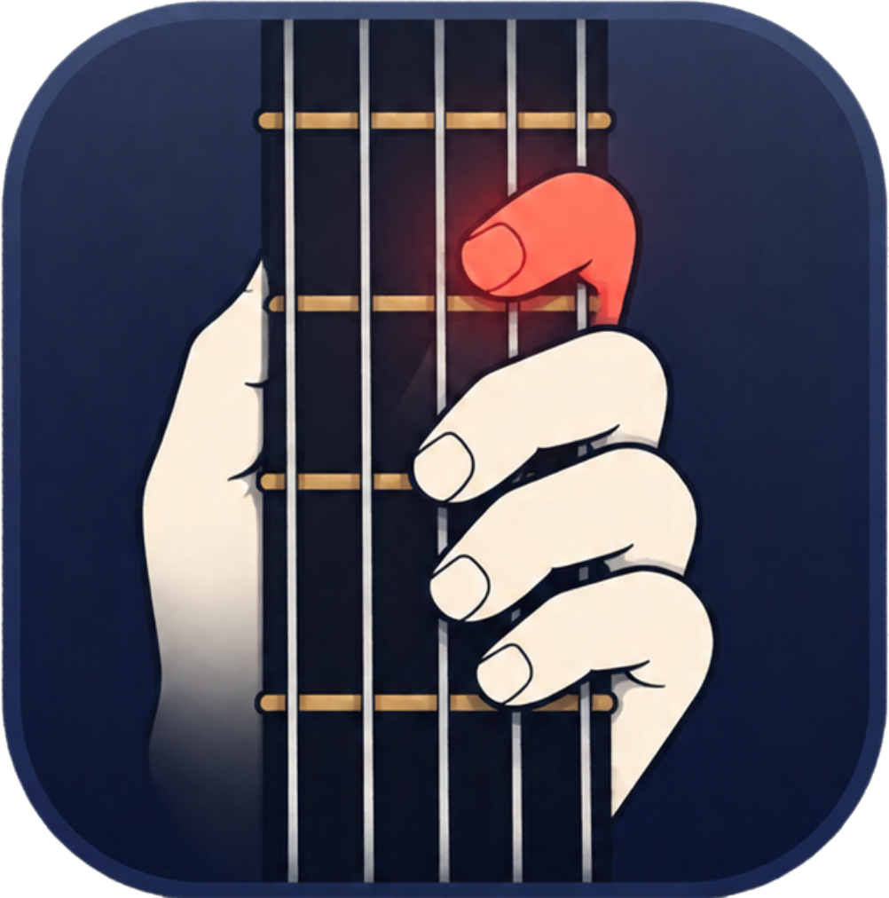

<p align="center">
  
</p>

<h1 align="center">Calo</h1>
<p align="center">Seu acorde mais firme. Aulas de violão popular do zero ao intermediário, sem partitura.</p>

---

App para Android e iPhone com dois modos:

- **Aluno**: as 24 aulas com diagramas de acorde, batidas, dedilhados e tablaturas, a tarefa de cada semana para marcar e o progresso do curso.
- **Professor**: o roteiro de cada aula com tempo de cada bloco, o que preparar, dicas, erros comuns, critério de sucesso, checklist de avaliação e um campo de anotações por aula. Com um toque o professor vê o mesmo material do aluno.

Também tem um dicionário com 44 acordes, as batidas e dedilhados usados no curso e um metrônomo com clique, vibração e "tocar no tempo".

## Currículo

| Módulo | Aulas | Conteúdo |
| --- | --- | --- |
| 1. Iniciante | 1 a 8 | Partes do violão, postura, Em, Am, C, G, D, E, A, Dm, batida baixo e cima, batida pop, a sequência G, D, Em, C, dedilhado P-I-M-A, ler cifra, tocar e cantar |
| 2. Básico | 9 a 16 | Acordes com sétima e o blues de 12 compassos, baixo alternado (sertanejo e country), F com meia pestana, famílias de acordes, capotraste, reggae, pestana inteira, tocar com metrônomo e com a gravação |
| 3. Intermediário | 17 a 24 | Baixos que caminham (G/B, D/F#), pop rock com abafado e power chords, 7M e m7 da MPB, bossa nova simplificada, sus, add9 e ligados, pentatônica e primeiro solo, tons menores e transposição, montagem de arranjo |

Cada aula foi pensada para 60 minutos com o professor e 10 a 15 minutos por dia de prática em casa.

## Rodar no celular

Requisitos: Node 20 ou mais novo e o app **Expo Go** no celular (Play Store ou App Store).

```bash
npm install
npx expo start
```

Aponte a câmera (iPhone) ou o Expo Go (Android) para o QR code do terminal. Celular e computador precisam estar na mesma rede Wi-Fi; se não der, use `npx expo start --tunnel`.

## Gerar o app instalável

Com uma conta gratuita na Expo:

```bash
npm install -g eas-cli
eas login
eas build -p android --profile preview   # gera um .apk para instalar direto
eas build -p ios                         # precisa de conta de desenvolvedor Apple
```

## Estrutura

```
src/
  app/            telas (expo-router): perfil, abas (aulas, acordes, ritmo, ajustes) e aula/[id]
  components/     diagrama de acorde, tablatura, batidas, metrônomo, visão do aluno e do professor
  content/        currículo: acordes.ts, ritmos.ts, tipos.ts e aulas/a01.ts a a24.ts
  store/          progresso salvo no aparelho (armazenamento.ts é o único que toca no AsyncStorage)
  lib/            log.ts (único que usa console) e midia.ts (imagens e sons)
assets/
  marca/          ícone, nome e slogan exportados do Canva
  sons/           cliques do metrônomo
scripts/
  conferir-conteudo.ts   confere acordes, batidas e tempo de cada roteiro
```

## Qualidade

```bash
npm run typecheck    # TypeScript
npm run lint         # ESLint rápido, com as 3 regras do vibe-coding-toolkit
npm run lint:typed   # ESLint com checagem de tipos
npm run conferir     # valida o currículo
```

As regras `quality/max-lines` (350 linhas por arquivo), `quality/no-direct-console` e `quality/no-direct-data-access` vêm copiadas sem alteração de [vibe-coding-toolkit](https://github.com/soumatheusgomes/vibe-coding-toolkit) e estão em `error`, com zero violações.

## Licença

Código sob licença MIT. O conteúdo das aulas e a marca Calo pertencem ao autor.
